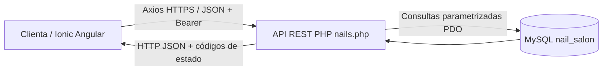

# Nail Studio: arquitectura y evidencia de análisis asistido por IA

## Objetivo
Aplicación móvil multiplataforma Ionic + Angular (componentes standalone) para que una clienta se registre, consulte servicios, reserve, reprograme, edite notas y cancele citas de un salón de uñas. API REST PHP/PDO y MySQL como persistencia.

## Diagrama cliente → API → base de datos

## Endpoints y métodos HTTP
| Método | Ruta | Autenticación | Descripción |
|---|---|---|---|
| POST | /nails.php?resource=register | pública | Registrar clienta |
| POST | /nails.php?resource=login | pública | Iniciar sesión y emitir token |
| POST | /nails.php?resource=logout | Bearer | Invalidar token |
| GET | /nails.php?resource=services | pública | Listar servicios |
| GET | /nails.php?resource=appointments | Bearer | Ver mis citas |
| POST | /nails.php?resource=appointments | Bearer | Agendar |
| PUT | /nails.php?resource=appointments&id=ID | Bearer | Reprogramar con todos los campos |
| PATCH | /nails.php?resource=appointments&id=ID | Bearer | Modificar solo las notas |
| DELETE | /nails.php?resource=appointments&id=ID | Bearer | Cancelación lógica |
| GET | /nails.php?resource=profile | Bearer | Ver perfil |
| PATCH | /nails.php?resource=profile | Bearer | Editar perfil |

## Contratos JSON
POST register: `{"name":"Ana Pérez","email":"ana@example.com","password":"claveSegura123","phone":"6181234567"}`
POST login: `{"email":"ana@example.com","password":"claveSegura123"}`
Respuesta login 200: `{"status":"success","data":{"token":"<token-aleatorio>","user":{"id":1,"name":"Ana Pérez","email":"ana@example.com","phone":"6181234567","role":"client"}}}`
GET services 200: `{"status":"success","data":[{"id":1,"name":"Manicure clásico","description":"...","price":"180.00","duration_minutes":45}]}`
POST/PUT appointments: `{"service_id":1,"start_at":"2026-12-10 11:00:00","notes":"Color rosa"}`
PATCH notes: `{"notes":"Diseño francés"}`
Respuesta error: `{"status":"error","message":"Horario ocupado; selecciona otro"}` con HTTP 409.
Otros códigos: 201 creado, 400 JSON inválido, 401 sesión ausente o vencida, 404 recurso inexistente, 405 verbo no permitido, 422 validación, 503 base de datos no disponible.

## Angular
`NailApiService` centraliza Axios, métodos CRUD, encabezado Authorization, modelos tipados, timeout y normalización de errores. `SalonPage` muestra LoadingController durante las peticiones, ToastController para respuestas y AlertController para confirmar cancelaciones. Los estados y acciones se actualizan tras respuesta exitosa.

## Modelo de datos
`users (1) → (N) appointments (N) → (1) services`; `users (1) → (N) auth_tokens`.
Contraseñas con password_hash/password_verify. Token opaco almacenado solo como hash SHA-256 en MySQL. Cada clienta solo puede gestionar sus citas mediante validación de propietario en servidor. La API comprueba solapamientos tomando en cuenta la duración del servicio y serializa operaciones por día usando GET_LOCK. Una única especialista atiende citas en esta primera versión.

## Evidencia documentada del uso de IA
**Herramienta:** ChatGPT (asistente de programación). **Propósito:** analizar la implementación existente y proponer mejoras de arquitectura, contrato REST, UX y seguridad.
- **Hallazgo:** el login anterior simulaba una sesión administrativa al fallar PHP. **Mejora:** eliminar el bypass y reportar errores de red.
- **Hallazgo:** el SQL existente era de inventario y el modelo de usuarios estaba desacoplado del objetivo. **Mejora:** esquema de clientas, servicios, citas y tokens.
- **Hallazgo:** los formularios anteriores no persistían citas. **Mejora:** servicio Angular Axios y endpoints reales GET/POST/PUT/PATCH/DELETE con carga y errores.
- **Riesgos detectados:** doble reserva por solicitudes simultáneas, filtración de datos y horarios fuera de servicio. **Controles:** bloqueo por día, restricciones de propiedad y validación en backend.
Esta sección acredita una propuesta y cambios asistidos por IA; **no constituye evidencia de QA ni pruebas de producción**. Validar en ambiente local antes de publicar.

## Pendientes para producción
Usar HTTPS y URL de API por ambiente (no localhost en móvil), limitar intentos de login, endurecer CORS, definir zonas horarias/feriados/especialistas, respaldos, política de privacidad, limpieza periódica de tokens vencidos y pruebas automatizadas de concurrencia.
