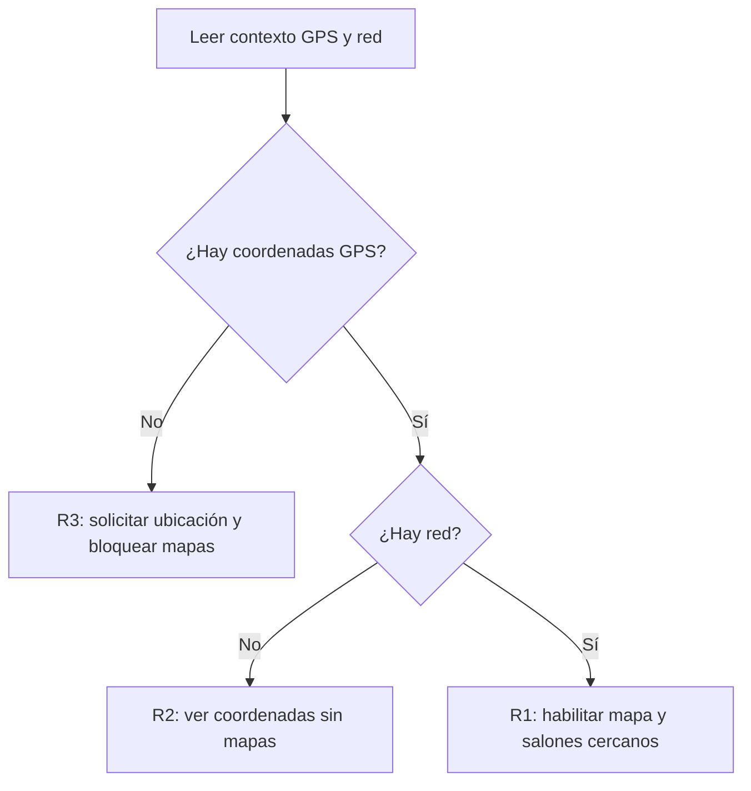

# Reglas basadas en contexto — Nail Studio

## Variables
1. `tieneUbicacion`: hay coordenadas **reales** obtenidas mediante el servicio GPS.
2. `tieneRed`: estado informado por `navigator.onLine` y eventos `online/offline`. Es una señal estimada, **no verifica acceso efectivo a Internet**.

## Tabla: tres reglas
| Regla | GPS | Red | Comportamiento |
|---|---|---|---|
| R1 | Sí | Sí | Habilita enlaces a Google Maps y búsqueda de salones cercanos |
| R2 | Sí | No | Conserva coordenadas pero deshabilita enlaces que requieren red |
| R3 | No | Cualquiera | Solicita geolocalización y mantiene mapas deshabilitados |

La R3 tiene prioridad: ninguna función de mapas personalizados debe depender de coordenadas ausentes. No implementamos una geocerca de salón porque no se dispone de la ubicación oficial del negocio.

## Diagrama de reglas

## Código
- `src/app/services/reglas-contexto.ts`: función pura `evaluarContexto`.
- `src/app/pages/salon/salon.page.ts`: combina signals GPS/red con `computed`.
- `src/app/pages/salon/salon.page.html`: panel de decisiones y enlaces reales sujetos a `decisionReal`.

## Tres escenarios de prueba y evidencia
En **Ubicación → Reglas de contexto → Escenario**, tomar capturas:
1. **Escenario 1: GPS y red** → R1, enlaces habilitados **solo en el resultado de simulación**.
2. **Escenario 2: GPS sin red** → R2, enlaces deshabilitados.
3. **Escenario 3: sin GPS con red** → R3, solicitar ubicación, enlaces deshabilitados.

La simulación no cambia los datos reales de GPS ni el estado de conectividad ni el acceso real a los enlaces; sirve para validar la lógica de decisiones. Para pruebas de sensores reales, usar «Contexto real del dispositivo» y cambiar la red o los permisos GPS en el teléfono.

## Documento corto: apoyo de IA
**Prompt empleado:**
> En mi aplicación Nail Studio hecha con Ionic, Angular y Capacitor ya tengo un servicio de GPS y otro para conectividad. Diseña tres reglas basadas en al menos dos variables de contexto. Separa la decisión en una función pura, da prioridad a no tener ubicación, bloquea enlaces dependientes de red y propón un diagrama Mermaid y tres escenarios reproducibles. No inventes la posición de un salón y distingue simulaciones de lecturas reales.

**Contribución:** ChatGPT ayudó a estructurar los casos como tabla de verdad, definir prioridades, separar reglas del acceso a sensores y proponer un panel de tres pruebas. El control de enlaces permanece anclado al contexto real aun durante la simulación.

**Validación posterior pendiente en el equipo:** compilar (`npm run build`), probar las tres opciones, guardar tres capturas y, si el docente lo solicita, cambiar permisos/red reales. No se afirma haber compilado el código local o grabado evidencia desde el teléfono.
